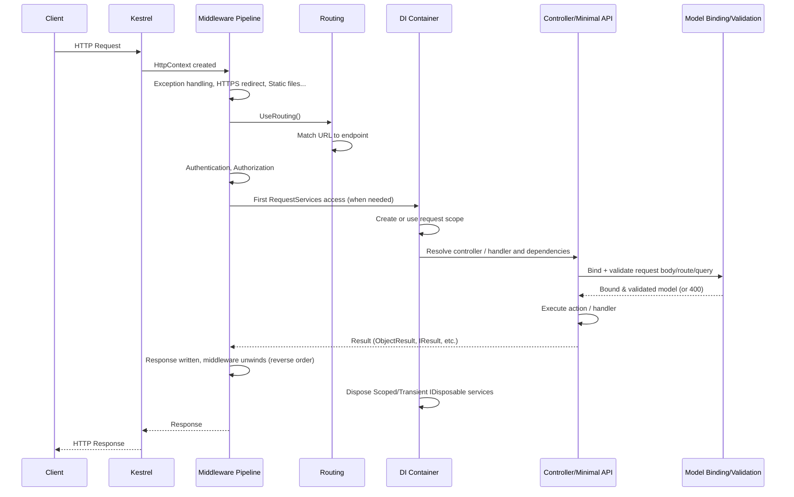

# ASP.NET Core Request Lifecycle & Dependency Injection — Interview Notes

*Interview-focused explanations of ASP.NET Core request processing, dependency injection lifetimes, registrations, factories, and common DI pitfalls. Code snippets illustrate the concepts.*

---

## Table of Contents

1. [Part 1 — ASP.NET Core Request Lifecycle](#part-1--aspnet-core-request-lifecycle)
2. [Part 2 — DI Service Lifetimes](#part-2--di-service-lifetimes)
3. [Part 3 — Interface vs Concrete Registration](#part-3--interface-vs-concrete-registration)
4. [Part 4 — Service Factories](#part-4--service-factories)
5. [Part 5 — Advanced DI Concepts](#part-5--advanced-di-concepts)
6. [Part 6 — ASP.NET Core DI Reference Additions](#part-6--aspnet-core-di-reference-additions)
7. [Cheat Sheet](#cheat-sheet)

---

## Part 1 — ASP.NET Core Request Lifecycle

### 1.1 The big picture



### 1.2 Stage-by-stage breakdown

| Stage | What happens internally |
|---|---|
| **1. Kestrel receives request** | Kestrel (the web server) parses the raw HTTP request and creates an `HttpContext` object carrying the request, response, user, items dictionary, and access to `RequestServices`. |
| **2. Request DI scope** | ASP.NET Core provides a request scope through `HttpContext.RequestServices`. The scope is created lazily when `RequestServices` is first accessed, not necessarily before the first middleware runs. This is the scope that makes `AddScoped` mean one instance per request. |
| **3. Middleware pipeline (request side)** | Middleware runs in the exact order it was registered with `app.Use...()`, each one calling `await next()` to pass control forward. Typical order: exception handler → HTTPS redirection → static files → routing → CORS → authentication → authorization → custom middleware → endpoint. |
| **4. Routing (`UseRouting`)** | The routing middleware matches the request's URL + HTTP verb against registered routes/attributes and picks a matching `Endpoint`. It does **not** execute it yet — it just attaches the chosen endpoint to `HttpContext.GetEndpoint()`. |
| **5. Auth middleware** | `UseAuthentication()` figures out *who* the user is (populates `HttpContext.User`). `UseAuthorization()` checks *whether* they're allowed to hit the matched endpoint (policies/roles). |
| **6. Endpoint execution (`UseEndpoints` / `MapControllers` / Minimal API)** | This is where the actual controller action or minimal API delegate finally runs. For MVC, the framework creates the controller instance via DI. For Minimal APIs, the handler delegate's parameters are resolved via DI + binding automatically. |
| **7. DI resolution for the endpoint** | The controller/handler's constructor (or method parameters, for Minimal APIs) are resolved from `HttpContext.RequestServices` — i.e., from the **per-request scope**. Any `Scoped` service resolved here (directly or transitively) will be the *same instance* for the rest of this request. |
| **8. Model binding & validation** | For MVC controllers, route values, query string, headers, and body (JSON) are bound onto action parameters/DTOs. Data annotations (`[Required]`, `[Range]`, etc.) or `IValidatableObject` run; with `[ApiController]`, invalid model state automatically produces a `400 Bad Request` before the action runs. Minimal API validation behavior is separate and depends on the framework version/configuration. |
| **9. Action/handler executes** | Your business logic runs, using the injected services. |
| **10. Result execution** | The returned `IActionResult` / `IResult` / POCO is serialized (JSON by default) and written to the response. |
| **11. Middleware pipeline (response side)** | Control unwinds back **up** through the same middleware, in **reverse order** — each middleware's code *after* its `await next()` call now executes (e.g., response logging, adding headers). |
| **12. Scope disposal** | When the request completes, ASP.NET Core disposes the request scope. Disposable `Scoped` services and disposable `Transient` services created through that scope are disposed with it. `Singleton` services are not disposed per request; container-created singletons are disposed when the root provider shuts down. |

### 1.3 Middleware order matters — mental model

Think of middleware as **nested functions**, not a flat list:

```
Middleware1(
    Middleware2(
        Middleware3(
            Endpoint()
        )
    )
)
```

Code *before* `await next()` runs on the way **in** (request); code *after* `await next()` runs on the way **out** (response) — in reverse order.

```csharp
app.Use(async (context, next) =>
{
    Console.WriteLine("A - before");
    await next();
    Console.WriteLine("A - after");
});

app.Use(async (context, next) =>
{
    Console.WriteLine("B - before");
    await next();
    Console.WriteLine("B - after");
});

app.Run(async context =>
{
    Console.WriteLine("Endpoint");
    await context.Response.WriteAsync("Hello");
});
```

With this registration order, the console output is:

```
A - before
B - before
Endpoint
B - after
A - after
```

**Why:** each middleware wraps the next one. `A` calls `next()` which runs `B`, which calls `next()` which runs the endpoint. Once the endpoint finishes, control returns to `B`'s code *after* `next()`, then to `A`'s code *after* `next()`. This is the same pattern as a call stack unwinding.

Reversing middleware registration reverses the order of the "before" log statements and, correspondingly, the unwind order of the "after" statements. If middleware returns without calling `next()`, later middleware and the endpoint do not run; code after that `return` in the same middleware does not run either.

### Middleware and scoped dependencies

Convention-based middleware is normally constructed once when the application pipeline is built. Therefore, a Scoped service should not be constructor-injected into this middleware; doing so attempts to use a request-lifetime service from an app-lifetime component. Instead, inject it into `InvokeAsync`, which runs for each request:

```csharp
public class AuditMiddleware
{
    private readonly RequestDelegate _next;
    public AuditMiddleware(RequestDelegate next) => _next = next;

    public async Task InvokeAsync(HttpContext context, IAuditService auditService)
    {
        await auditService.RecordAsync(context.TraceIdentifier);
        await _next(context);
    }
}
```

Alternatively, implement `IMiddleware` and register the middleware itself as Scoped or Transient; the middleware factory resolves it from the request services.

---

## Part 2 — DI Service Lifetimes

### 2.1 The three lifetimes

| Lifetime | Created | Lives until | Disposed | Typical use |
|---|---|---|---|---|
| **Transient** | Every time it's resolved/injected | No sharing is guaranteed by the lifetime; references may be held longer by consumers | Disposable instances are disposed with the scope that resolved them; root-resolved disposables are held until the root provider is disposed | Lightweight, stateless services: validators, mappers, calculators |
| **Scoped** | Once per scope (≈ once per HTTP request) | Rest of that request/scope | End of the request/scope | Per-request state: `DbContext`, unit-of-work, "current user" services |
| **Singleton** | Created on first resolution, or supplied as an instance | Entire application lifetime | Container-created instances are disposed at app shutdown | App-wide shared/cached state: `IMemoryCache`, configuration |

### 2.2 Instance identity across resolutions and requests

This example tracks instance IDs across the three DI lifetimes:

```csharp
// IOperation.cs
public interface IOperation
{
    Guid OperationId { get; }
}

public class Operation : IOperation, IDisposable
{
    public Guid OperationId { get; } = Guid.NewGuid();
    public Operation() => Console.WriteLine($"[CREATED] Operation {OperationId}");
    public void Dispose() => Console.WriteLine($"[DISPOSED] Operation {OperationId}");
}

// Marker interfaces so we can register the SAME class 3 different ways
public interface IOperationTransient : IOperation { }
public interface IOperationScoped : IOperation { }
public interface IOperationSingleton : IOperation { }

public class OperationTransient : Operation, IOperationTransient { }
public class OperationScoped : Operation, IOperationScoped { }
public class OperationSingleton : Operation, IOperationSingleton { }
```

```csharp
// Program.cs
builder.Services.AddTransient<IOperationTransient, OperationTransient>();
builder.Services.AddScoped<IOperationScoped, OperationScoped>();
builder.Services.AddSingleton<IOperationSingleton, OperationSingleton>();
```

```csharp
// OperationsController.cs
[ApiController]
[Route("api/[controller]")]
public class OperationsController : ControllerBase
{
    private readonly IOperationTransient _transient1;
    private readonly IOperationTransient _transient2;
    private readonly IOperationScoped _scoped1;
    private readonly IOperationScoped _scoped2;
    private readonly IOperationSingleton _singleton1;
    private readonly IOperationSingleton _singleton2;

    public OperationsController(
        IOperationTransient transient1, IOperationTransient transient2,
        IOperationScoped scoped1, IOperationScoped scoped2,
        IOperationSingleton singleton1, IOperationSingleton singleton2)
    {
        _transient1 = transient1; _transient2 = transient2;
        _scoped1 = scoped1; _scoped2 = scoped2;
        _singleton1 = singleton1; _singleton2 = singleton2;
    }

    [HttpGet]
    public object Get() => new
    {
        Transient1 = _transient1.OperationId,
        Transient2 = _transient2.OperationId,
        Scoped1 = _scoped1.OperationId,
        Scoped2 = _scoped2.OperationId,
        Singleton1 = _singleton1.OperationId,
        Singleton2 = _singleton2.OperationId
    };
}
```

The instance IDs show the lifetime rules: two Transient resolutions are different, two Scoped resolutions within one request share an instance, and Singleton resolutions share one instance across requests. A request scope disposes the Scoped services and the disposable Transient services it created when the request ends; Singleton services are disposed when the application shuts down.

### 2.3 Common mistakes

| Mistake | Why it's a problem |
|---|---|
| Injecting `Scoped`/`Transient` into a `Singleton`'s constructor | **Captive Dependency** — the Scoped instance gets "captured" and lives as long as the Singleton (forever), defeating its purpose (e.g., a captured `DbContext` reused across thousands of requests → stale data, thread-safety bugs, memory growth). Covered in depth in [Part 5](#53-captive-dependency-problem). |
| Registering `DbContext`-holding services as `Singleton` | EF Core's `DbContext` is **not thread-safe**; a Singleton is shared across concurrent requests → race conditions and exceptions. |
| Assuming `Transient` means "cheap" automatically | It's cheap for lightweight objects, but if a Transient's constructor does expensive work (e.g., opens a file, hits a DB), that expensive work repeats on *every single injection*. |
| Storing mutable per-request state in a `Singleton` field | That field is shared by *all* concurrent users — one user's request can silently overwrite another's data (a very common source of "random" bugs in production). |
| Manually calling `.Dispose()` on a DI-resolved service | The container owns disposal. Manually disposing a Scoped/Transient object *before* the container is done with it (it's still injected elsewhere in the same request) can crash other consumers mid-request ("Cannot access a disposed object"). |

---

## Part 3 — Interface vs Concrete Registration

### 3.1 The two forms

```csharp
// Form A — interface to implementation
services.AddTransient<IReportService, ReportService>();

// Form B — concrete type only
services.AddTransient<ReportService>();
```

Both let the container construct `ReportService` and inject its own dependencies automatically. The difference is **what key the container stores it under**, and therefore **what you're allowed to ask for**.

| | Form A: `AddTransient<IReportService, ReportService>()` | Form B: `AddTransient<ReportService>()` |
|---|---|---|
| Registered under | `IReportService` | `ReportService` (its own concrete type) |
| Can inject `IReportService` into a constructor? | ✅ Yes | ❌ No — throws at startup/resolution: no service for type `IReportService` |
| Can inject `ReportService` (concrete) into a constructor? | ❌ No, unless *also* separately registered | ✅ Yes |
| Can swap implementation later without touching consumers? | ✅ Yes — change the registration line only | ❌ No — every consumer references the concrete type directly |
| Mockable in unit tests (constructor-injected consumers)? | ✅ Easy — mock `IReportService` | ⚠️ Harder — either mock the concrete class (needs virtual members) or use the real thing |
| Typical use case | Services with multiple implementations, or where you want loose coupling / testability | Small internal helper classes, or "sealed leaf" utility classes with no need for abstraction |

### Interface registration must match the requested type

```csharp
public interface IReportService { string Generate(); }
public class ReportService : IReportService
{
    public string Generate() => "report content";
}

// Program.cs — Form B only
builder.Services.AddTransient<ReportService>();
```

```csharp
public class ReportController : ControllerBase
{
    // Constructor depends on the INTERFACE, but only the concrete type is registered
    public ReportController(IReportService svc) { ... }
}
```

`InvalidOperationException: Unable to resolve service for type 'IReportService' while attempting to activate 'ReportController'.` The container has **no entry** for `IReportService` — only for the concrete `ReportService` type. Registration keys are exact types; there's no automatic "well it implements this interface, so use it" fallback.

Fix it by either changing the constructor to depend on `ReportService` directly, or changing the registration to `AddTransient<IReportService, ReportService>()`.

### 3.2 Multiple implementations of one interface

```csharp
public interface INotifier { Task SendAsync(string msg); }
public class EmailNotifier : INotifier { public Task SendAsync(string msg) { Console.WriteLine($"EMAIL: {msg}"); return Task.CompletedTask; } }
public class SmsNotifier : INotifier { public Task SendAsync(string msg) { Console.WriteLine($"SMS: {msg}"); return Task.CompletedTask; } }

builder.Services.AddTransient<INotifier, EmailNotifier>();
builder.Services.AddTransient<INotifier, SmsNotifier>();
```

When multiple registrations exist for one service type, injecting a **single** `INotifier` returns the **last one registered**. To obtain every implementation, inject `IEnumerable<INotifier>`; the container returns them in registration order.

Avoid blocking an asynchronous operation with `.Wait()` in request-handling code; use `await` instead.

### 3.3 Testing & maintainability impact

- **Form A (interface)** lets you write `new AlertController(new FakeNotifier())` in a unit test with zero DI container involved, or use a mocking library (`Moq`, `NSubstitute`) to assert `SendAsync` was called.
- **Form B (concrete)** forces your test to either use the real class (pulling in its real dependencies/side effects) or make its members `virtual` so a mocking framework can override them — messier, and it signals the class probably *should* have an interface.
- **Rule of thumb:** use interface registration for anything crossing an architectural boundary (services, repositories, gateways to external systems) — use concrete-type registration only for small, self-contained, "leaf" helper classes that will realistically only ever have one implementation (e.g., a stateless CSV parser used internally).
- Library registration extensions can use `TryAddScoped`/`TryAddSingleton` so they provide defaults without replacing an application's existing registration. `TryAddEnumerable` is useful when adding one implementation to a collection registration without duplicating that same implementation.

---

## Part 4 — Service Factories

### 4.1 Why factories are needed

The built-in DI container is great at "give me one thing per type", but sometimes you need to **decide which implementation, or how to construct it, at runtime** — based on data that isn't known until the request is running (a config value, a header, an enum, the current user's plan tier). That's what a **factory** is for: a piece of code whose *job* is to produce an instance of something, deciding the details at call-time instead of at registration-time.

### 4.2 Factory delegate registrations (`AddTransient`/`AddScoped`/`AddSingleton` with a lambda)

Every `Add*` method has an overload that takes `Func<IServiceProvider, T>` instead of just a type — this **is** DI's built-in factory mechanism:

```csharp
builder.Services.AddScoped<IOrderService>(sp =>
{
    var db = sp.GetRequiredService<AppDbContext>();
    var logger = sp.GetRequiredService<ILogger<OrderService>>();
    return new OrderService(db, logger, DateTime.UtcNow); // extra runtime-only arg
});

builder.Services.AddTransient<INotifier>(sp =>
{
    var config = sp.GetRequiredService<IConfiguration>();
    return config["Notifier:Provider"] == "sms"
        ? new SmsNotifier()
        : new EmailNotifier();
});
```

The lifetime you choose (`AddTransient`/`AddScoped`/`AddSingleton`) still governs **how often the factory lambda runs** — a `Transient` factory runs on every resolution, a `Scoped` factory runs once per scope, a `Singleton` factory runs exactly once.

### 4.3 `Func<T>` factory pattern — resolve lazily / choose at call time

Sometimes a consumer needs to create **new instances on demand**, not just have one injected once. The built-in container does not automatically resolve `Func<T>`; register the delegate explicitly. A Scoped delegate can use the current request scope:

```csharp
builder.Services.AddTransient<Operation>();
builder.Services.AddScoped<Func<Operation>>(sp => () => sp.GetRequiredService<Operation>());
```

```csharp
public class BatchJobRunner
{
    private readonly Func<Operation> _operationFactory;
    public BatchJobRunner(Func<Operation> operationFactory) => _operationFactory = operationFactory;

    public void RunBatch(int count)
    {
        for (int i = 0; i < count; i++)
        {
            var op = _operationFactory(); // a FRESH Operation every call, on demand
            Console.WriteLine($"Batch item {i}: {op.OperationId}");
        }
    }
}
```

This is different from just injecting `IEnumerable<Operation>` or a single `Operation` — the caller controls **when** and **how many** instances get created, which plain constructor injection can't do.

### 4.4 Explicit factory classes

For anything more elaborate than a one-line lambda, write a real factory class implementing an interface — this keeps `Program.cs` clean and the factory itself unit-testable:

```csharp
public interface INotifierFactory
{
    INotifier Create(string channel); // "email" | "sms"
}

public class NotifierFactory : INotifierFactory
{
    private readonly IServiceProvider _provider;
    public NotifierFactory(IServiceProvider provider) => _provider = provider;

    public INotifier Create(string channel) => channel switch
    {
        "sms" => _provider.GetRequiredService<SmsNotifier>(),
        "email" => _provider.GetRequiredService<EmailNotifier>(),
        _ => throw new ArgumentException($"Unknown channel: {channel}")
    };
}
```

```csharp
builder.Services.AddTransient<EmailNotifier>();
builder.Services.AddTransient<SmsNotifier>();
builder.Services.AddScoped<INotifierFactory, NotifierFactory>();
```

The factory uses `IServiceProvider`, so keep it Scoped (or otherwise ensure it receives the active scope). A Singleton factory would resolve from the root provider, which can make disposable Transients live until shutdown and cannot safely resolve Scoped services.

```csharp
public class AlertController : ControllerBase
{
    private readonly INotifierFactory _factory;
    public AlertController(INotifierFactory factory) => _factory = factory;

    [HttpGet("{channel}")]
    public async Task<IActionResult> Send(string channel)
    {
        var notifier = _factory.Create(channel);
        await notifier.SendAsync("hello");
        return Ok();
    }
}
```

### 4.5 Keyed services (new in .NET 8) — the modern replacement for many hand-rolled factories

.NET 8 introduced **keyed DI services** — you register multiple implementations of the same interface under different *keys*, and resolve the right one by key, without writing a factory class at all:

```csharp
builder.Services.AddKeyedTransient<INotifier, EmailNotifier>("email");
builder.Services.AddKeyedTransient<INotifier, SmsNotifier>("sms");
```

```csharp
public class AlertController : ControllerBase
{
    private readonly IServiceProvider _provider;
    public AlertController(IServiceProvider provider) => _provider = provider;

    [HttpGet("{channel}")]
    public async Task<IActionResult> Send(string channel)
    {
        var notifier = _provider.GetRequiredKeyedService<INotifier>(channel);
        await notifier.SendAsync("hello");
        return Ok();
    }
}
```

You can also inject a *specific* key directly into a constructor with `[FromKeyedServices("email")]`:

```csharp
public class WelcomeEmailSender
{
    public WelcomeEmailSender([FromKeyedServices("email")] INotifier notifier) { ... }
}
```

Resolving an unregistered key with `GetRequiredKeyedService` throws `InvalidOperationException`; validate external key input and translate invalid values into an appropriate client response.

### 4.6 Factory Design Pattern vs DI container "factory" behavior — don't confuse them

| | **Factory Design Pattern** (GoF) | **DI container factory delegate / keyed services** |
|---|---|---|
| What it is | A class/method whose sole responsibility is object creation logic, independent of any DI framework — works even with `new` and no container at all | A *feature of the DI container* letting you customize how the container itself builds/selects an instance |
| Lives where | Anywhere — a plain C# pattern | Inside `services.Add...(sp => ...)` or `AddKeyedX` registrations |
| Who calls it | Your own code (`factory.Create(...)`) | The container, internally, when something asks to resolve `T` |
| Needed even without DI? | Yes | No — meaningless without a DI container |

**How DI reduces the need for manually-written factories:** many use cases — "pick an implementation based on a string/enum", "construct with extra runtime info", or "create instances on demand" — can use factory delegate registrations or keyed services. The built-in container does not automatically register `Func<T>`; if a delegate is useful, register it explicitly or use a dedicated factory.

**When a hand-written factory class is still the better design:**
- The selection/construction logic is genuinely complex (multiple steps, validation, caching, fallback chains) — a class is easier to read, test, and reuse than a fat lambda in `Program.cs`.
- You need the *same* factory logic usable **outside** of a request/DI context too (e.g., a background job, a console tool, a unit test) without spinning up the whole container.
- You want the factory itself to be independently unit-tested without touching the DI container at all.

---

## Part 5 — Advanced DI Concepts

### 5.1 Constructor injection vs method injection

**Constructor injection** (the standard, preferred approach in ASP.NET Core) — dependencies are declared as constructor parameters and the container supplies them when it builds the object:

```csharp
public class OrderService
{
    private readonly AppDbContext _db;
    public OrderService(AppDbContext db) => _db = db; // constructor injection
}
```

**Method injection** — ASP.NET Core doesn't support "inject into any method" generically, but there are two real patterns people mean by this:
1. **`[FromServices]` on an MVC action parameter** — inject a service into a single action method instead of the whole controller's constructor (useful when only one action needs it):
```csharp
[HttpGet]
public IActionResult Get([FromServices] IReportService reportService)
    => Ok(reportService.Generate());
```
2. **Minimal API handler parameters** — every parameter of a minimal API delegate is auto-resolved from DI (no attribute needed, unless it's ambiguous with route/query binding):
```csharp
app.MapGet("/reports", (IReportService reportService) => reportService.Generate());
```

### 5.2 `IServiceProvider` and service resolution

`IServiceProvider` is the standard abstraction for resolving services — `GetService<T>()` returns `null` when no registration is found, while `GetRequiredService<T>()` throws. You rarely resolve services directly in application code (constructor injection is preferred), but the abstraction is used by the framework and is passed to DI factory delegates.

```csharp
var service = app.Services.GetRequiredService<IReportService>(); // resolving from the ROOT provider
```

⚠️ Resolving a `Scoped` service directly from `app.Services` (the root provider) throws when scope validation is enabled. If validation is disabled, the service is resolved from the root scope and effectively lives until the root provider is disposed. Resolve request services from `HttpContext.RequestServices`, or create a scope for background work (see 5.4).

### 5.3 Captive Dependency Problem

**What it is:** a `Singleton` (or a `Transient` resolved *from* a Singleton) captures a reference to a `Scoped` (or another `Transient` meant to be short-lived) dependency in its constructor. Because the Singleton is only constructed **once**, the Scoped dependency it captured gets held onto **forever** — effectively becoming a de-facto Singleton itself, but without anyone intending that.

```csharp
public class CacheWarmerSingleton   // registered as Singleton
{
    private readonly AppDbContext _db; // Scoped! ⚠️
    public CacheWarmerSingleton(AppDbContext db) => _db = db;
}

builder.Services.AddSingleton<CacheWarmerSingleton>();
builder.Services.AddScoped<AppDbContext>();
```

Enable DI validation in the host:

Add this line right before `builder.Build()`:

```csharp
builder.Host.UseDefaultServiceProvider(opts =>
{
    opts.ValidateScopes = true;   // catches captive dependencies at startup
    opts.ValidateOnBuild = true;  // validates the ENTIRE graph immediately, not lazily
});
```

With scope validation enabled, activating this service graph throws `InvalidOperationException: Cannot consume scoped service 'AppDbContext' from singleton 'CacheWarmerSingleton'.` `ValidateOnBuild` checks registered service graphs when the provider is built; it does not execute services or guarantee validation of every runtime factory/keyed-service path. The ASP.NET Core Development environment enables scope validation by default; configure validation explicitly in CI as well.

**Fix options:**
1. Change `CacheWarmerSingleton` to `Scoped` (if that's semantically correct), or
2. Inject `IServiceScopeFactory` instead of `AppDbContext` directly, and create a fresh scope each time you need the DbContext (see 5.4).

### 5.4 `IServiceScopeFactory` and nested scopes

Background work (hosted services, queued jobs, timers) runs **outside** any HTTP request — there's no ambient scope to grab a `Scoped` service from. `IServiceScopeFactory` lets you create one manually:

```csharp
public class CacheWarmerSingleton
{
    private readonly IServiceScopeFactory _scopeFactory;
    public CacheWarmerSingleton(IServiceScopeFactory scopeFactory) => _scopeFactory = scopeFactory;

    public async Task WarmAsync()
    {
        await using AsyncServiceScope scope = _scopeFactory.CreateAsyncScope(); // a brand-new, short-lived scope
        var db = scope.ServiceProvider.GetRequiredService<AppDbContext>();
        var orders = await db.Orders.ToListAsync();
        // scope disposed at end of `using` -> db (and any other Scoped it created) disposed too
    }
}
```

**Separate scopes:** a scope created while another is active is not a hierarchical child that inherits its parent's scoped instances. Each scope has its **own** instances of Scoped services. This is common in batch/worker scenarios that process multiple logical units in one long-running process.

For EF Core background work, `IDbContextFactory<TContext>` is another option when the job needs to create and dispose independent `DbContext` instances explicitly. Use a scope when the unit of work needs several Scoped services together.

Each independently created scope receives its own Scoped service instances, just as separate HTTP requests do:

```csharp
using var scope1 = app.Services.CreateScope();
using var scope2 = app.Services.CreateScope();

var op1 = scope1.ServiceProvider.GetRequiredService<IOperationScoped>();
var op2 = scope2.ServiceProvider.GetRequiredService<IOperationScoped>();

Console.WriteLine(op1.OperationId == op2.OperationId); // false
```

`CreateScope()` creates an independent scope, so the two operation IDs differ.

### 5.5 `IOptions<T>` vs `IOptionsSnapshot<T>` vs `IOptionsMonitor<T>`

```csharp
public class MailSettings { public string Host { get; set; } = ""; public int Port { get; set; } }
builder.Services.Configure<MailSettings>(builder.Configuration.GetSection("Mail"));
```

| | Lifetime | Re-reads config if file changes? | Typical use |
|---|---|---|---|
| `IOptions<T>` | Singleton | ❌ No — the value is cached and does not track reloads | Config that does not need to change while the app runs |
| `IOptionsSnapshot<T>` | Scoped | ✅ Recomputed once **per scope/request** when configuration reload is supported | A per-request view that remains consistent within one request |
| `IOptionsMonitor<T>` | Singleton | ✅ Tracks changes when the configuration provider supports reload; supports `OnChange` callbacks | Config needed inside a Singleton/background service that must react to live changes |

⚠️ Because `IOptionsSnapshot<T>` is **Scoped**, injecting it into a **Singleton** is exactly the captive dependency problem from 5.3 — this is precisely why `IOptionsMonitor<T>` exists (it's Singleton-safe).

### 5.6 Singleton depending on Scoped/Transient — summary rule

> **A long-lived service must not accidentally capture a shorter-lived dependency.**
> A Singleton must not capture a Scoped service. It may depend on a Transient only if keeping that instance for the Singleton's full lifetime is safe. Scoped services can use Scoped, Transient, or Singleton dependencies; Transients can be resolved from any scope, but their dependencies are still governed by the scope from which they are resolved.

### 5.7 Open generic registrations

Register a generic type once, and the container builds a **closed** version for whatever `T` is actually requested:

```csharp
public interface IRepository<T> { T? GetById(int id); }
public class Repository<T> : IRepository<T> where T : class
{
    public T? GetById(int id) => default; // demo
}

builder.Services.AddScoped(typeof(IRepository<>), typeof(Repository<>));
```

Now `IRepository<Order>`, `IRepository<Customer>`, etc. all resolve automatically — you never register each closed type individually.

### 5.8 Decorator pattern with DI

"Decorating" wraps an existing registered implementation with extra behavior (logging, caching, retries) **without changing the original class or its consumers**:

```csharp
public class LoggingNotifierDecorator : INotifier
{
    private readonly INotifier _inner;
    private readonly ILogger<LoggingNotifierDecorator> _logger;
    public LoggingNotifierDecorator(INotifier inner, ILogger<LoggingNotifierDecorator> logger)
    {
        _inner = inner; _logger = logger;
    }
    public async Task SendAsync(string msg)
    {
        _logger.LogInformation("Sending: {Msg}", msg);
        await _inner.SendAsync(msg);
        _logger.LogInformation("Sent.");
    }
}
```

The built-in container has no `Decorate()` API (unlike Scrutor, a popular add-on library) — the manual pattern is a factory delegate that resolves the *original* concrete type and wraps it:

```csharp
builder.Services.AddTransient<EmailNotifier>();  // the real implementation, concrete registration
builder.Services.AddTransient<INotifier>(sp =>
    new LoggingNotifierDecorator(sp.GetRequiredService<EmailNotifier>(), sp.GetRequiredService<ILogger<LoggingNotifierDecorator>>()));
```

Now every consumer that injects `INotifier` transparently gets the logging behavior wrapped around the real notifier.

### 5.9 DI validation

`ValidateScopes` detects invalid scoped-service resolution from the root provider or a Singleton. `ValidateOnBuild` checks registered service descriptors when the provider is built. Enable both in Development/CI to catch many invalid dependency graphs early; they do not execute application code or guarantee that every runtime factory, keyed lookup, or service-locator path is valid.

### 5.10 `IEnumerable<T>` resolution — multiple registrations

As shown in 3.2, injecting `IEnumerable<INotifier>` (instead of a single `INotifier`) returns **every** registered implementation, in registration order:

```csharp
public class BroadcastService
{
    private readonly IEnumerable<INotifier> _notifiers;
    public BroadcastService(IEnumerable<INotifier> notifiers) => _notifiers = notifiers;

    public async Task BroadcastAsync(string msg)
    {
        foreach (var notifier in _notifiers)
            await notifier.SendAsync(msg); // sends via EmailNotifier AND SmsNotifier
    }
}
```

### 5.11 Disposal — `IDisposable` and `IAsyncDisposable`

At the end of the owning scope, the container disposes the Scoped/Transient services it created. Async disposal is used when the scope is disposed asynchronously; if a service implements only `IAsyncDisposable`, dispose the scope asynchronously (for example, with `CreateAsyncScope` and `await using`). **The container will not dispose a service instance supplied by the caller** (e.g., `AddSingleton<T>(existingInstance)`); the caller owns its lifetime.

```csharp
public class FileWriterService : IAsyncDisposable
{
    private readonly StreamWriter _writer = new("log.txt", append: true);
    public async ValueTask DisposeAsync()
    {
        await _writer.FlushAsync();
        await _writer.DisposeAsync();
        Console.WriteLine("FileWriterService disposed.");
    }
}
builder.Services.AddScoped<FileWriterService>();
```

The container uses asynchronous disposal when the owning scope is disposed asynchronously. Use `CreateAsyncScope`/`await using` when resolving services that require async disposal. Disposal happens in **reverse order of creation** (last created, first disposed), mirroring nested `using` blocks; the order depends on resolution order, not registration order.

---

## Part 6 — ASP.NET Core DI Reference Additions

### 6.1 DI terminology and the composition root

| Term | Meaning |
|---|---|
| **IoC** | Broad principle: control of object creation or execution flow is delegated to a framework or caller. |
| **DI** | Technique for supplying an object's dependencies from outside instead of having it construct them. |
| **DIP** | Design principle that high-level code should depend on abstractions. A DI container does not guarantee DIP if code still depends on concrete implementations. |

In ASP.NET Core, `Program.cs` and its registration extension methods form the **composition root**. Keep application wiring there; after `builder.Build()`, adding registrations to the original collection does not change the already-built provider.

### 6.2 Constructor resolution and property injection

The container recursively resolves public constructor parameters. A missing registration usually throws `InvalidOperationException` when the service is resolved; scope validation and `ValidateOnBuild` can catch many invalid graphs earlier.

If a class has multiple public constructors, the container chooses a resolvable constructor whose parameters are a superset of the other viable constructors. If viable constructors are ambiguous, simplify the constructors or use a factory; `[ActivatorUtilitiesConstructor]` can disambiguate construction through `ActivatorUtilities`.

Circular constructor dependencies throw `InvalidOperationException`. Break the cycle by extracting a shared collaborator or changing the dependency direction; do not hide it with ad hoc service-location calls.

The built-in container does not support general property injection. Prefer constructor injection so required dependencies are visible and the object is valid when constructed. For MVC actions, Minimal API handlers, and middleware `InvokeAsync` methods, ASP.NET Core can bind service parameters at the framework boundary.

### 6.3 Registration details

The registered **service type** is the lookup key: registering `CsvReportWriter` does not also register `IReportWriter`. To share one instance through both types, register the concrete service and forward the abstraction to it using a factory.

Library registration helpers can use `TryAdd` to supply a default only when absent, `TryAddEnumerable` to avoid duplicate service/implementation pairs, and `Replace` or `RemoveAll<T>` when intentionally overriding registrations. For multiple registrations, a single service resolution returns the last registration; `IEnumerable<T>` returns all registrations in order.

### 6.4 `ActivatorUtilities` and framework-managed services

`ActivatorUtilities` constructs a type that is not registered, resolving some constructor parameters from DI and accepting other arguments explicitly:

```csharp
var job = ActivatorUtilities.CreateInstance<ReportJob>(serviceProvider, "monthly");
```

The caller owns and must dispose an object created this way. ASP.NET Core uses this construction model in places such as `TypeFilter`; use `[ServiceFilter]` when the filter itself is registered, and `[TypeFilter]` when ASP.NET Core should construct it with `ActivatorUtilities`.

| Service | Typical lifetime | Important note |
|---|---|---|
| `ILogger<T>` | Singleton | Safe to inject into services of any lifetime. |
| `BackgroundService` / `IHostedService` | Singleton | Create a scope for scoped work on each iteration. |
| `IHttpClientFactory` | Singleton | Prefer injecting it into long-lived services and create clients as needed. |
| Typed `HttpClient` client | Transient | Avoid retaining it in a singleton, which can undermine handler rotation. |
| EF Core `DbContext` from `AddDbContext` | Scoped | Not thread-safe; use `IDbContextFactory<T>` for independent instances. |

### 6.5 Request-bound services and named options

Do not capture `HttpContext` or request data in singleton fields. `IHttpContextAccessor` is a singleton that exposes the current context through `AsyncLocal`; read it at call time, and expect no current context in background work. For filters, use `[ServiceFilter]` or `[TypeFilter]` as appropriate. For fire-and-forget or hosted work, pass plain data and create a fresh scope with `IServiceScopeFactory`; never use request-scoped services after the request ends.

Named options configure multiple values of the same options type. Use `IOptionsMonitor<T>.Get(name)` in long-lived services or `IOptionsSnapshot<T>.Get(name)` in scoped services; do not inject the scoped snapshot into a singleton.

### 6.6 Choose an implementation without spreading resolution logic

| Need | Prefer |
|---|---|
| A small, local choice | Direct conditional logic. |
| A fixed set of named implementations | Keyed services. |
| Implementations that self-report whether they can handle a request | `IEnumerable<T>` with a selector. |
| Complex creation or runtime input | An explicit factory. |

Keep selection policy in one service. Validate or allow-list any key derived from request input before resolving a keyed service.

---

## Cheat Sheet

### Request lifecycle, top to bottom
`Kestrel receives request → HttpContext created → middleware pipeline (request side, in registration order; RequestServices creates the scope on first access) → routing matches endpoint → auth (who? / allowed?) → endpoint executes (controller/minimal API constructed via DI) → model binding + validation → action runs → result serialized → middleware pipeline (response side, reverse order) → request scope disposed at completion`

### DI lifetimes
| | Created | Same instance across... | Disposed |
|---|---|---|---|
| Transient | Every resolution | Never | End of the scope that resolved it |
| Scoped | Once per scope | Everything within one request/scope | End of that request/scope |
| Singleton | Once, app-wide | Every request, forever | App shutdown |

### Registration patterns
- `services.AddX<IFoo, Foo>()` — interface → implementation (preferred; swappable, mockable).
- `services.AddX<Foo>()` — concrete only; only injectable as `Foo`, not `IFoo`.
- `services.AddX<IFoo, FooA>(); services.AddX<IFoo, FooB>();` — injecting `IFoo` gives the **last** one; injecting `IEnumerable<IFoo>` gives **both**.
- `services.AddX<IFoo>(sp => ...)` — factory delegate; runs per the chosen lifetime's rules.
- `services.AddKeyedX<IFoo, FooImpl>("key")` — .NET 8 keyed services; resolve via `GetRequiredKeyedService<IFoo>("key")` or `[FromKeyedServices("key")]`.
- `services.AddX(typeof(IFoo<>), typeof(Foo<>))` — open generic; closed per requested `T`.

### Factories
- Built-in factory delegate (`Add*(sp => ...)`) covers many "decide at runtime" needs — reach for this first.
- Explicitly register a `Func<T>` factory if a consumer needs to create new instances **on demand**; the built-in container does not auto-wire it.
- A real factory class when selection logic is non-trivial or needs to be usable/testable outside DI.
- Keyed services (.NET 8) replace most hand-written "switch on a string and resolve" factories.
- GoF Factory pattern ≠ DI container factory feature — one is a standalone OOP pattern, the other only exists because of the container.

### Common pitfalls
- Captive dependency: a Singleton directly or transitively holding a shorter-lived dependency → enable `ValidateScopes`/`ValidateOnBuild`. Validation catches registered graphs but cannot replace testing runtime factory paths.
- Resolving Scoped from the root `IServiceProvider` (`app.Services`) instead of `HttpContext.RequestServices` or a created scope.
- `DbContext` (or anything not thread-safe) registered as Singleton.
- Forgetting `IOptionsSnapshot<T>` is Scoped — don't inject it into a Singleton; use `IOptionsMonitor<T>` there instead.
- Assuming interface registration is automatic — the container has zero knowledge of interfaces unless you explicitly register `<IFoo, Foo>`.
- Manually calling `.Dispose()` on a container-managed instance — let the container own disposal.
- Background work (`BackgroundService`, timers, queued jobs) grabbing a Scoped service directly instead of going through `IServiceScopeFactory.CreateScope()`.

